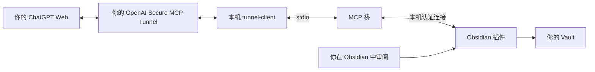

# Obsidian Context MCP

让 **ChatGPT Web 读取你的 Obsidian 笔记、理解当前选区，并把修改作为候选交回 Obsidian 审阅**。

一个 Obsidian 桌面插件 + 独立 stdio MCP 桥。你使用自己的 ChatGPT、自己的 Vault 和自己的 Secure MCP Tunnel；服务无需开放公网端口。笔记可以叫任何名字，无需叫 STEM。

**[完整中文部署教程](docs/DEPLOYMENT.zh-CN.md)** · **[下载桌面部署包](https://github.com/AlexbeatsZ/obsidian-context-mcp/releases/latest)** · [分发方案研究](docs/DISTRIBUTION.md) · [数据与权限](docs/PRIVACY.md) · [工具 API](docs/API.md)



## 能做什么

- 读取最后活动的笔记、编辑器选区、附近文字，以及打开／最近／链接笔记的信息。切换到浏览器后仍保留上下文。
- 列出文件，按路径、标题、标签与正文搜索，按行读取文本。附件支持元数据查询。
- 提出编辑、新建、移动／重命名及回收候选；移动包含相关笔记链接调整。
- 在笔记正文内查看 diff，逐块或整体接受／拒绝；检查冲突并恢复已接受的修改。

每次写入都需要 Obsidian 本地审阅。远端没有接受、恢复或命令执行工具。工具可读取所配置 Vault 的允许文件；[了解实际数据范围](docs/PRIVACY.md)。

## 快速开始

需要桌面版 Obsidian 1.12+、Node.js 22+（建议 24 LTS）。Windows 与 macOS 有原有运行经验；Linux 目前以自动化检查为主，尚无桌面 UI 验收。手机／平板端不支持。

1. 下载 Release 的 `obsidian-context-mcp-desktop-<版本>.zip`，解压到固定的本机目录（不要放在 Vault 内）。这个包已打包 MCP 依赖，**无需 `npm install`**。
2. 在该目录的终端执行，替换为你自己的 Vault 绝对路径：

   ```sh
   npm run setup -- --vault "/absolute/path/to/your/vault"
   ```

3. 在 Obsidian 启用社区插件和 **Obsidian Context MCP**；在插件设置中把“本机项目目录”设为刚才的解压目录，然后重新加载插件。打开一篇 Markdown 笔记，执行：

   ```sh
   npm run doctor
   ```

4. 按[教程的 ChatGPT 接入步骤](docs/DEPLOYMENT.zh-CN.md#5-准备你自己的-openai-tunnel)创建自己的 Tunnel、填写本地凭据、启动连接并在 ChatGPT 中添加。

仅使用 Claude Desktop、Codex 等支持本地 stdio 的客户端时，可以直接连接 `dist/mcp.cjs`，无需 Tunnel；见教程第 9 节。

**先确认账号权限：**ChatGPT 的开发者模式、Platform Tunnel 使用权限与工作区关联是不同条件；仓库不保证任意免费／付费账号都已开放。插件不调用模型 API；远程 Tunnel 仍需你自己的运行凭据。它是自行部署方案，尚未提交 Obsidian 社区市场或 ChatGPT 公共插件目录。

## 从源码构建

```sh
git clone https://github.com/AlexbeatsZ/obsidian-context-mcp.git
cd obsidian-context-mcp
npm ci
npm run check
npm run package
```

`dist/obsidian-context-mcp-desktop-<版本>.zip` 是完整部署包；`dist/obsidian-context-mcp-<版本>.zip` 含 Obsidian 插件三文件及许可说明，不能单独完成 ChatGPT 接入。桌面包不包含 Node.js、Obsidian、tunnel-client、凭据或任何笔记。

维护者历史验收和原有机器运维记录分别见 [ACCEPTANCE](docs/ACCEPTANCE.md) 与 [OPERATIONS](docs/OPERATIONS.md)，新用户请以通用部署教程为准。发布方式及验证范围见[分发说明](docs/DISTRIBUTION.md)。

## License

[MIT](LICENSE)。打包依赖保留各自许可，详见 [THIRD_PARTY_NOTICES](THIRD_PARTY_NOTICES.md)。
